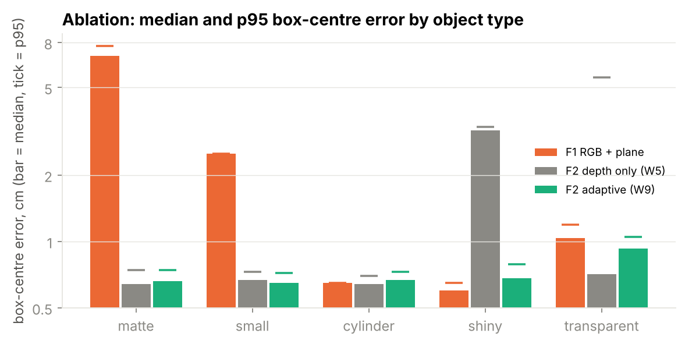
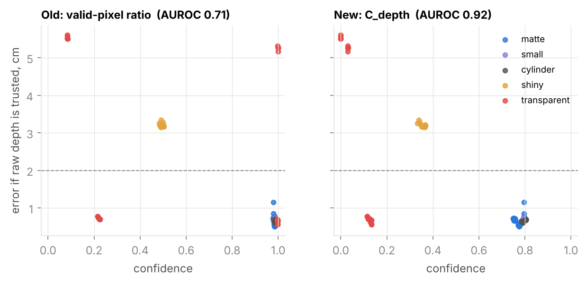

# S2 — Week 9: ablation and confidence calibration

Reproduce: `python scripts/s2_week9_ablation.py && python scripts/s2_week9_ablation.py --plot`

Mock desk frames: 5 seeds × 6 cases (RealSense / ZED Mini profiles; glass with 85 % or 100 % holes or see-through; simulated shiny mug). Error = 3D box-centre distance to ground truth (map frame).

| Object type | F1 RGB + plane: median / p95 (cm), recall | F2 depth only (W5) | F2 adaptive (W9) |
|---|---|---|---|
| matte | 6.96 / 7.74, 50 % | 0.64 / 0.74, 100 % | 0.66 / 0.74, 100 % |
| small | 2.51 / 2.51, 67 % | 0.67 / 0.73, 100 % | 0.65 / 0.72, 100 % |
| cylinder | 0.65 / 0.65, 100 % | 0.64 / 0.7, 100 % | 0.67 / 0.73, 100 % |
| shiny | 0.6 / 0.65, 100 % | 3.2 / 3.31, 100 % | 0.68 / 0.79, 100 % |
| transparent | 1.04 / 1.19, 100 % | 0.71 / 5.55, 100 % | 0.93 / 1.05, 100 % |
| all | 1.19 / 7.74, 73 % | 0.68 / 5.26, 100 % | 0.67 / 1.04, 100 % |

## Confidence calibration

C_depth = r_valid · exp(−σ_Z / τ), r_valid = genuine (non-desk) valid depth share, σ_Z = 1.4826·MAD of depth − 5×5 local median, τ = 1 cm.

Detecting "raw depth would put the box > 2 cm off" (20 of 150 objects): AUROC old valid-pixel ratio **0.712**, new C_depth **0.923**; fused confidence fixed 0.923 vs adaptive 0.923 (same ranking — the gain comes from the reliability gate, not the weights).

See-through glass: old confidence 0.998, new C_depth 0.08 (matte objects 0.771).

Limits: synthetic frames only; the shiny condition is a simulated specular model (50 % holes + 10 % spikes of 2–8 cm); real tape-measured ground truth is W12.

